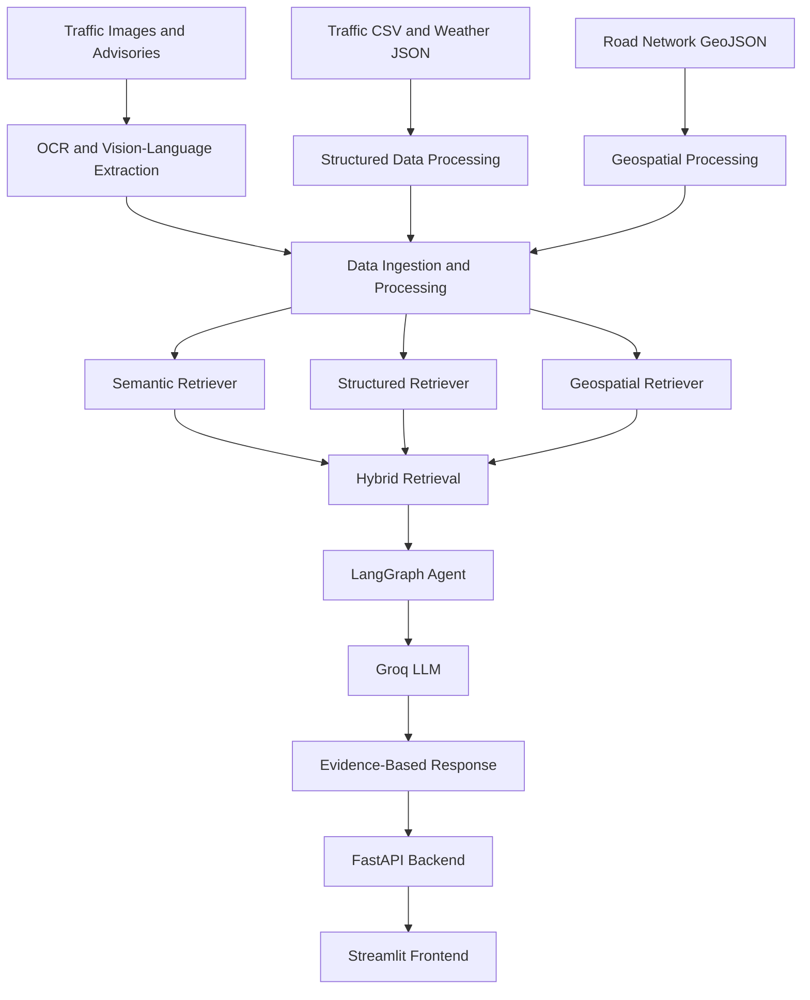

# UrbanPulse AI — Multimodal RAG & Agentic Traffic Intelligence

An AI-powered traffic intelligence platform that combines multimodal document understanding, semantic retrieval, structured data analysis, geospatial search, and agentic question answering to help users explore traffic-related information in Hyderabad.

## Overview

UrbanPulse AI is an end-to-end AI application designed to bring together different types of urban traffic information in one platform.

Traffic-related information is often distributed across images, advisories, structured datasets, weather records, and road network maps. UrbanPulse AI brings these sources together using a Retrieval-Augmented Generation (RAG) pipeline and an agentic architecture.

Users can ask natural-language questions and receive answers grounded in the available retrieved evidence.

## Key Features

- **AI Traffic Assistant:** Ask natural-language questions about traffic information.
- **Multimodal Document Processing:** Process advisory images using OCR and vision-language extraction, then prepare the extracted information for semantic retrieval.
- **Semantic Retrieval:** Retrieve relevant information using Sentence Transformer embeddings.
- **Hybrid Retrieval:** Combine semantic and structured retrieval for more relevant results.
- **Geospatial Intelligence:** Explore road network information and perform location-based analysis.
- **Interactive Road Network Map:** Visualize Hyderabad road segments using Folium.
- **Traffic Analytics:** Explore traffic records, congestion distributions, vehicle flow, and speed analytics using Plotly.
- **Advisory Intelligence:** Examine extracted traffic advisory information, junctions, and diversion details.
- **Weather Intelligence:** Explore the stored weather snapshot and its measurements.
- **Agentic Workflow:** Use LangGraph to coordinate query handling, retrieval, and response generation.
- **REST API:** Access the backend through FastAPI.

## System Architecture



## Technology Stack

| Component | Technologies |
|---|---|
| Programming Language | Python |
| Development Environment | VS Code |
| Dependency Management | uv |
| Frontend | Streamlit |
| Backend API | FastAPI |
| Agentic Orchestration | LangGraph |
| LLM | Groq API |
| Embeddings | Sentence Transformers |
| Data Processing | Pandas, NumPy |
| Retrieval | Semantic and Hybrid Retrieval |
| Geospatial Processing | Shapely, PyProj |
| Maps | Folium, Streamlit-Folium |
| Visualization | Plotly |
| Image Processing | Pillow, RapidOCR |
| Version Control | Git and GitHub |

## Project Structure

```text
UrbanPulseAI/
│
├── data/
│   ├── Advisories/
│   │   └── images/
│   ├── Maps/
│   ├── Weather/
│   ├── traffic/
│   └── processed/
│
├── scripts/
│   ├── analyze_advisory_image.py
│   ├── answer_generator.py
│   ├── api.py
│   ├── build_multimodal_records.py
│   ├── chunk_documents.py
│   ├── clean_roads.py
│   ├── embed_multimodal_records.py
│   ├── generate_traffic.py
│   ├── geospatial_retriever.py
│   ├── hybrid_retriever.py
│   ├── ingest_data.py
│   ├── ingest_images.py
│   ├── intent_router.py
│   ├── retrieve_chunks.py
│   ├── retrieve_data.py
│   ├── retrieve_multimodal.py
│   ├── structured_retriever.py
│   └── urbanpulse_agent.py
│
├── streamlit_app.py
├── pyproject.toml
├── requirements.txt
├── uv.lock
├── .python-version
├── .gitignore
└── README.md
```

## Installation and Setup

### 1. Clone the repository

```bash
git clone https://github.com/PurpleCoder-23/Multimodal-RAG--UrbanPulseAI.git
```

### 2. Navigate to the project directory

```bash
cd Multimodal-RAG--UrbanPulseAI
```

### 3. Install dependencies

Install uv if it is not already installed:

```bash
pip install uv
```

Install the project dependencies:

```bash
uv sync
```

### 4. Configure environment variables

Create a `.env` file in the project root directory.

Add your Groq API key:

```env
GROQ_API_KEY=your_groq_api_key_here
```

Replace the placeholder with your own API key.

**Important:** Never upload your `.env` file or expose API keys on GitHub.

### 5. Run the FastAPI backend

Open a terminal in the project directory:

```bash
uv run uvicorn scripts.api:app --reload
```

Backend URL:

http://localhost:8000

API documentation:

http://localhost:8000/docs

Health endpoint:

http://localhost:8000/health

### 6. Run the Streamlit frontend

Open a second terminal in the same project directory:

```bash
uv run streamlit run streamlit_app.py
```

Frontend URL:

http://localhost:8501

Keep both the backend and frontend terminals running while using the application.

## Data and Dataset Information

The project currently uses the following data:

- **Traffic Advisory:** A stored advisory document and its associated image, with OCR and vision-language extraction outputs.
- **Road Network:** OpenStreetMap-derived road network GeoJSON files covering a selected Hyderabad area.
- **Traffic Records:** A synthetic dataset containing 500 traffic records for analytics and testing.
- **Weather Information:** A stored Hyderabad weather snapshot.
- **Processed Data:** Extracted records, text chunks, metadata, and generated semantic embeddings.

### Dataset Limitations

- The traffic dataset is synthetic and does not represent verified real-time traffic observations.
- The weather data is a stored historical snapshot, not a live weather feed.
- The traffic advisory included in the current dataset is historical and has expired.
- The available road network covers a selected area, not the entire Hyderabad road network.

Therefore, the current application demonstrates traffic intelligence workflows using available and simulated data; it should not be treated as a live traffic navigation or emergency advisory service.

## Future Enhancements

- Integration of verified real-time traffic APIs.
- Live weather data integration.
- Expanded Hyderabad road network coverage.
- Direct image-based multimodal embedding and retrieval.
- Advanced spatial and route analysis.
- Improved agentic reasoning and tool orchestration.
- Docker-based containerization.
- Automated testing and CI/CD using GitHub Actions.
- Cloud deployment and production monitoring.

## Author

**PurpleCoder-23**

GitHub: https://github.com/PurpleCoder-23

---

## License

A license has not yet been added to this repository.
